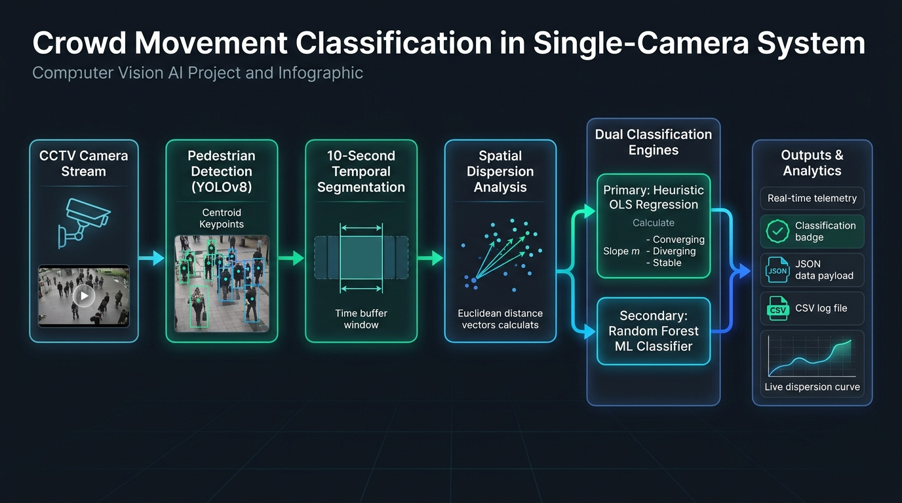
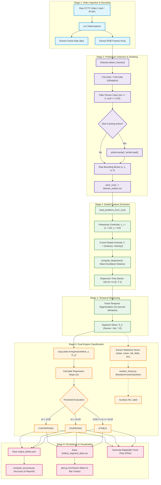
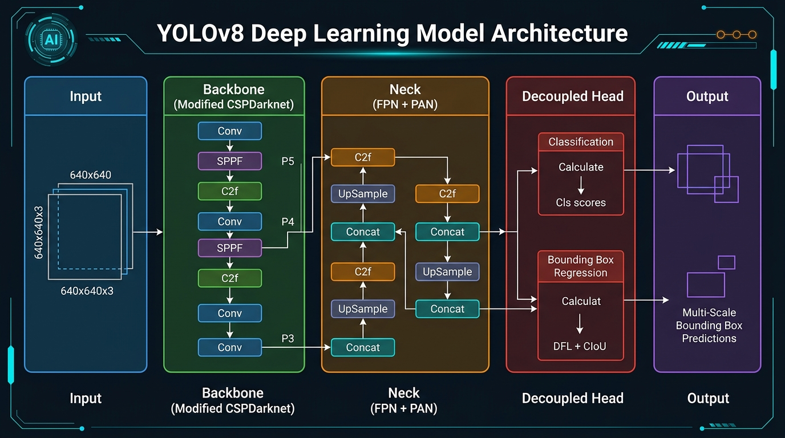
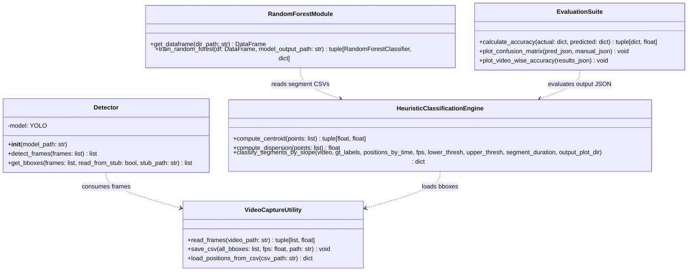
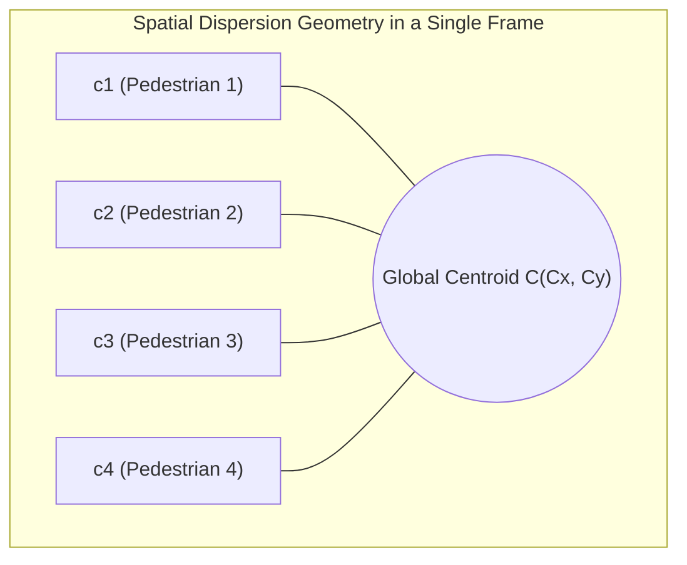
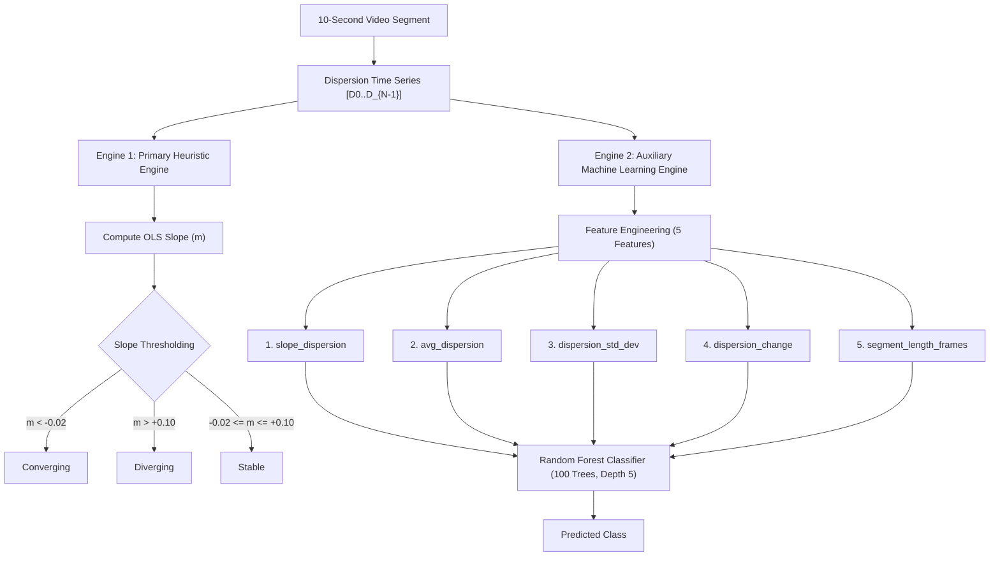
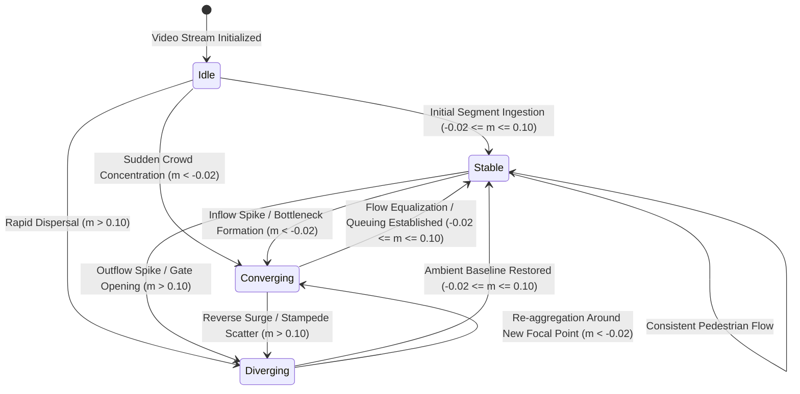
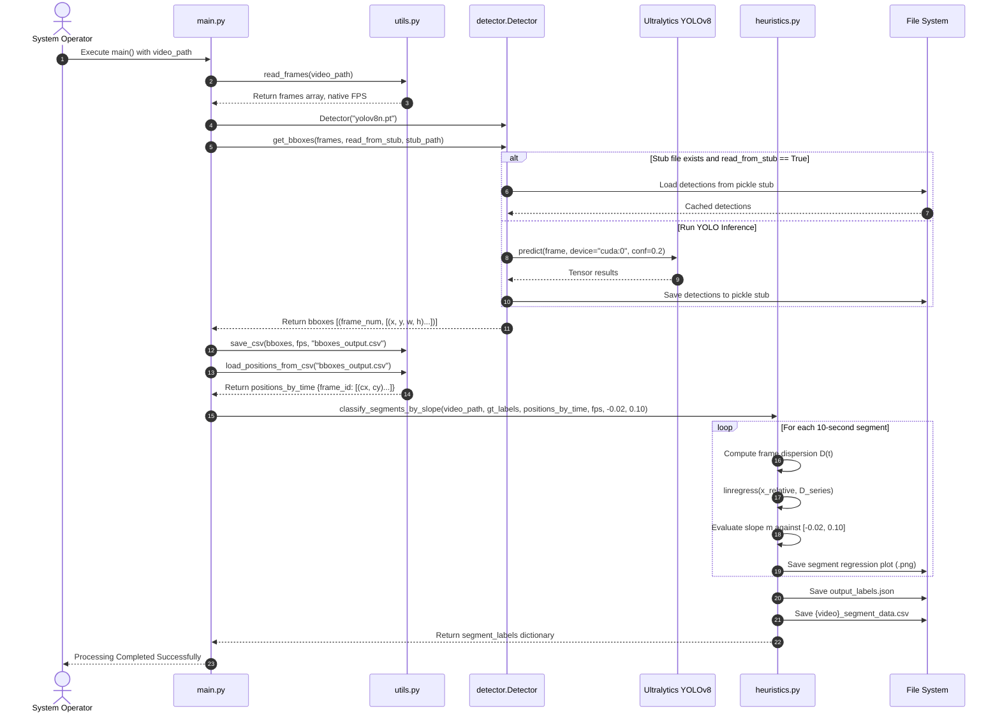

# System Architecture Specification
## Crowd Movement Classification in Single-Camera System

[](file:///d:/EDUCATION/CODEING/CROWD_DETECTION_SINGLE_CAMERA/Guide/SYSTEM-ARCHITECTURE.md)
[](file:///d:/EDUCATION/CODEING/CROWD_DETECTION_SINGLE_CAMERA/Guide/SYSTEM-ARCHITECTURE.md)
[](file:///d:/EDUCATION/CODEING/CROWD_DETECTION_SINGLE_CAMERA/LICENSE)
[](file:///d:/EDUCATION/CODEING/CROWD_DETECTION_SINGLE_CAMERA/Guide/Chandan%20Msc%20project%20report.pdf)

> **Document Version**: 1.0  
> **Author**: Chandan Adhikary (Roll: `C91/CSC/231009`, Reg: `D01-1111-0026-23`)  
> **Supervisor**: Prof. Banani Saha  
> **Affiliation**: Department of Computer Science and Engineering, University of Calcutta  
> **Primary Report**: [Chandan Msc project report.pdf](file:///d:/EDUCATION/CODEING/CROWD_DETECTION_SINGLE_CAMERA/Guide/Chandan%20Msc%20project%20report.pdf)  
> **Project Guide**: [README.md](file:///d:/EDUCATION/CODEING/CROWD_DETECTION_SINGLE_CAMERA/README.md)  
> **License**: [MIT License (Open to all)](file:///d:/EDUCATION/CODEING/CROWD_DETECTION_SINGLE_CAMERA/LICENSE)

---

### System Architecture Overview Infographic

<p align="center">
  
</p>

---

## Table of Contents

1. [Executive Architectural Summary](#1-executive-architectural-summary)
2. [End-to-End Pipeline Architecture](#2-end-to-end-pipeline-architecture)
3. [Component & Class Decomposition](#3-component--class-decomposition)
4. [Data Flow & Transformation Pipeline](#4-data-flow--transformation-pipeline)
5. [Mathematical & Coordinate Geometry Foundations](#5-mathematical--coordinate-geometry-foundations)
6. [Temporal Windowing & Cognitive Perception Rationale](#6-temporal-windowing--cognitive-perception-rationale)
7. [Dual-Engine Classification System](#7-dual-engine-classification-system)
8. [Behavioral State Transition & Decision Logic](#8-behavioral-state-transition--decision-logic)
9. [Runtime Sequence & Execution Lifecycle](#9-runtime-sequence--execution-lifecycle)
10. [Data Contracts & Storage Schemas](#10-data-contracts--storage-schemas)
11. [Hardware, Resource Budgeting & Deployment Topology](#11-hardware-resource-budgeting--deployment-topology)
12. [Architectural Trade-Offs & Design Rationale](#12-architectural-trade-offs--design-rationale)

---

## 1. Executive Architectural Summary

The system is designed to provide **real-time, interpretable, single-camera macro crowd behavior classification** without relying on multi-camera stereoscopy or fragile cross-frame pedestrian re-identification (Re-ID).

```
┌──────────────────────────────────────────────────────────────────────────────┐
│                             SYSTEM ARCHITECTURE                              │
│                                                                              │
│   [ CCTV Stream / MP4 ]                                                      │
│            │                                                                 │
│            ▼                                                                 │
│   ┌──────────────────┐      ┌─────────────────────────┐                      │
│   │   Video Ingestion│ ───> │ Deep Learning Detection │                      │
│   │   (OpenCV I/O)   │      │ (YOLOv8 + CUDA Accel)   │                      │
│   └──────────────────┘      └───────────┬─────────────┘                      │
│                                         │ [Bounding Boxes: (x, y, w, h)]     │
│                                         ▼                                    │
│                             ┌─────────────────────────┐                      │
│                             │ Spatial Feature Engine  │                      │
│                             │ (Centroids & Dispersion)│                      │
│                             └───────────┬─────────────┘                      │
│                                         │ [Frame Dispersion Series D(t)]     │
│                                         ▼                                    │
│                             ┌─────────────────────────┐                      │
│                             │ Temporal Windowing (10s)│                      │
│                             └───────────┬─────────────┘                      │
│                                         │ [Segment Slices: 250-300 Frames]   │
│                    ┌────────────────────┴────────────────────┐               │
│                    ▼                                         ▼               │
│         ┌───────────────────────┐               ┌─────────────────────────┐  │
│         │ Primary Engine:       │               │ Auxiliary Engine:       │  │
│         │ OLS Linear Regression │               │ Random Forest ML Model  │  │
│         │ & Heuristic Thresholds│               │ (5 Statistical Features)│  │
│         └──────────┬────────────┘               └────────────┬────────────┘  │
│                    │                                         │               │
│                    ▼                                         ▼               │
│         ┌───────────────────────┐               ┌─────────────────────────┐  │
│         │ 84.38% Accuracy       │               │ 75.00% Accuracy         │  │
│         │ (Converging/Diverging/│               │ (Borderline Nuanced     │  │
│         │  Stable Classification)               │  Pattern Resolution)    │  │
│         └──────────┬────────────┘               └────────────┬────────────┘  │
│                    │                                         │               │
│                    └────────────────────┬────────────────────┘               │
│                                         ▼                                    │
│                             ┌─────────────────────────┐                      │
│                             │ Output & Visualization  │                      │
│                             │ (JSON, CSV, Trend Plots)│                      │
│                             └─────────────────────────┘                      │
└──────────────────────────────────────────────────────────────────────────────┘
```

The design solves three fundamental challenges in urban automated surveillance:
1. **Severe Physical Occlusion**: Rather than tracking individual pedestrian identities across frames (which fails in high-density crowds), the system converts person detections in each frame into an aggregate **Spatial Dispersion Metric** $D_t$.
2. **Computational Overhead**: By replacing complex 3D CNNs or optical flow stability solvers with **Ordinary Least Squares (OLS) linear regression**, the pipeline runs at real-time speeds on commodity hardware.
3. **Auditability & Explainability**: Public safety applications require transparent decision-making. The core classification relies on an interpretable slope parameter $m = \frac{\Delta D}{\Delta t}$, directly expressing whether a crowd is contracting, expanding, or stationary.

---

## 2. End-to-End Pipeline Architecture

The end-to-end data pipeline is structured into six decoupled operational stages:



---

### 2.1 Deep Learning Detection Subsystem (YOLOv8)

The pedestrian detection subsystem utilizes the **YOLOv8** (Ultralytics) deep learning architecture. Below is the detailed architecture infographic depicting the multi-scale feature extraction, path aggregation neck, and anchor-free decoupled detection head:

<p align="center">
  
</p>

#### YOLOv8 Subsystem Components:
- **Input Processing**: High-resolution video frames (e.g., $640 \times 640 \times 3$) decoded via OpenCV.
- **Backbone (Modified CSPDarknet53)**: Hierarchical feature extraction utilizing standard convolutions, `C2f` (Cross Stage Partial with 2 Convolutions) modules for gradient flow preservation, and `SPPF` (Spatial Pyramid Pooling - Fast) for multi-receptive field context pooling.
- **Neck (PAN-FPN)**: Path Aggregation Feature Pyramid Network enabling bidirectional multi-scale feature propagation, fusing high-resolution spatial details with high-level semantic abstractions across scale levels $P_3, P_4, P_5$.
- **Decoupled Anchor-Free Head**: Isolates classification and bounding-box regression into separate convolutional heads:
  - *Classification Branch*: Uses Binary Cross-Entropy (BCE) Loss to predict class probabilities ($c = \text{person}$).
  - *Box Regression Branch*: Leverages Distribution Focal Loss (DFL) and Complete Intersection over Union (CIoU) Loss for sub-pixel boundary localization.
- **Inference Runtime**: Executed via PyTorch with CUDA acceleration (`cuda:0` on NVIDIA RTX 3050), supporting instant stub serialization via Python `pickle`.

---

## 3. Component & Class Decomposition

The architecture is strictly separated into single-responsibility functional units:



### Module Responsibilities:
1. **`utils.py` (I/O & Coordinate Preprocessing)**:
   - Reads raw frames from local media or network streams.
   - Converts raw YOLO detections into structured time-indexed CSV format.
   - Calculates bottom-center pedestrian anchor points $(x + w/2, y + h/2)$.
2. **`detector.py` (Inference & Serialization)**:
   - Encapsulates `ultralytics.YOLO` model lifecycle.
   - Dispatches inference tasks to GPU (`cuda:0`).
   - Implements disk-level stub caching (`pickle`) to eliminate redundant forward passes during development.
3. **`heuristics.py` (Spatial Analytics & Rule Engine)**:
   - Aggregates individual centroids into crowd-level centroids.
   - Computes Euclidean dispersion metric series.
   - Partitions video into 10-second segments.
   - Executes linear regression and evaluates heuristic thresholds.
   - Emits structured JSON, segment statistics CSV, and individual visualization graphs.
4. **`random_forest.py` (Machine Learning Extension)**:
   - Assembles tabular feature matrices from generated segment CSVs.
   - Performs stratified train/test split.
   - Fits an ensemble Random Forest classifier.
   - Generates Gini feature importance plots and evaluation heatmaps.
5. **`compute_accuracy.py` & `plot.py` (Benchmarking & Reporting)**:
   - Ingests ground truth annotations and predicted JSON files.
   - Calculates Precision, Recall, F1, and Overall Accuracy across multiple videos.
   - Renders publication-ready Seaborn bar charts and confusion matrices.

---

## 4. Data Flow & Transformation Pipeline

The following horizontal pipeline depicts the exact shape and schema evolution of data as it transitions across the system:


---

## 5. Mathematical & Coordinate Geometry Foundations

### 5.1 Centroid & Coordinate Mapping
Surveillance cameras view scenes from an elevated angle. Each detected bounding box is represented by coordinates $[x_{tl}, y_{tl}, w, h]$, where $(x_{tl}, y_{tl})$ is the upper-left bounding corner:

```
(x, y) ───────────────┐
  │                   │
  │     Pedestrian    │
  │     Detection     │
  │                   │
  └─────────┬─────────┘
        Centroid (c_x, c_y) = (x + w/2, y + h/2)
```

The representative anchor point $c_i$ for pedestrian $i$ is calculated as:
$$c_i = \left( x_i + \frac{w_i}{2}, \; y_i + \frac{h_i}{2} \right)$$

### 5.2 Global Center of Mass (Crowd Centroid)
For a frame containing $n$ detected pedestrians $(n \ge 1)$, the instantaneous center of mass $C = (C_x, C_y)$ is given by:
$$C_x = \frac{1}{n}\sum_{i=1}^{n} c_{i, x}, \quad C_y = \frac{1}{n}\sum_{i=1}^{n} c_{i, y}$$

### 5.3 Frame-Wise Spatial Dispersion
The dispersion metric $D$ quantifies the mean spread (spatial variance) of pedestrians around their geometric center:
$$D = \frac{1}{n} \sum_{i=1}^{n} \sqrt{(c_{i, x} - C_x)^2 + (c_{i, y} - C_y)^2}$$

*Boundary condition*:
$$D = 0.0 \quad \text{if } n = 0$$



### 5.4 Ordinary Least Squares (OLS) Linear Regression
Given a 10-second segment with $N$ frames, we construct normalized pairs:
$$(x_0, D_0), (x_1, D_1), \dots, (x_{N-1}, D_{N-1}) \quad \text{where } x_i \in [0, N-1]$$

Using relative index $x_i = i$ decouples each segment from the video's absolute time offset, ensuring position-invariant analysis.

We fit a linear model $D(x) = m \cdot x + c$ by minimizing the sum of squared errors:
$$\min_{m, c} \sum_{i=0}^{N-1} \left( D_i - (m \cdot x_i + c) \right)^2$$

Closed-form computation of the slope $m$:
$$m = \frac{N \sum_{i=0}^{N-1} x_i D_i - \left(\sum_{i=0}^{N-1} x_i\right) \left(\sum_{i=0}^{N-1} D_i\right)}{N \sum_{i=0}^{N-1} x_i^2 - \left(\sum_{i=0}^{N-1} x_i\right)^2}$$

The slope $m$ represents the rate of change of dispersion ($\frac{\mathrm{d}D}{\mathrm{d}t}$):
- **$m < 0$**: Dispersion is contracting $\implies$ Crowd converging.
- **$m > 0$**: Dispersion is expanding $\implies$ Crowd diverging.
- **$m \approx 0$**: Dispersion is constant $\implies$ Crowd stable.

---

## 6. Temporal Windowing & Cognitive Perception Rationale

The temporal window duration $d$ is set to **10 seconds**.

### Trade-Off Spectrum

| Window Duration | Temporal Resolution | Noise Susceptibility | Behavioral Context | Usability in Practice |
| :---: | :---: | :---: | :---: | :---: |
| **Short (2–5 sec)** | High | **Very High** (Gait fluctuations and temporary stops dominate trend) | Poor (Too brief to observe genuine gathering or dispersal) | High false positive rate |
| **Optimal (10 sec)** | **Balanced** | **Low** (Smooths random movement while preserving trend) | **Ideal** (Matches human dynamic observation window of 8–12 sec) | **Standard for CCTV surveillance** |
| **Long (20–30 sec)** | Low | Very Low | Poor (Averages out critical rapid transitions like sudden panic stampedes) | Delayed emergency alert |

$$\text{Frames per segment } N = \lfloor \text{FPS} \times 10 \rfloor$$
For standard CCTV (25–30 FPS), each window encompasses **250 to 300 discrete frames**, providing sufficient sample depth for statistically reliable OLS estimation.

---

## 7. Dual-Engine Classification System

The system implements a **hybrid classification strategy**, comparing a rule-based heuristic with a supervised learning model.



### 7.1 Engine 1: Primary Heuristic Classifier (Recommended)
- **Algorithm**: Deterministic boundary comparison against empirically calibrated thresholds:
  $$\text{Label} = \begin{cases}
  \textbf{Converging}, & \text{if } m < -0.02 \\
  \textbf{Diverging}, & \text{if } m > +0.10 \\
  \textbf{Stable}, & \text{if } -0.02 \le m \le +0.10
  \end{cases}$$
- **Strengths**: Zero training required, instant inference ($O(N)$ complexity), deterministic, 100% explainable, and achieves **84.38% benchmark accuracy**.

### 7.2 Engine 2: Supervised Random Forest Classifier (Auxiliary)
- **Algorithm**: Ensemble of 100 decision trees (`max_depth=5`, `random_state=42`) trained on 5 engineered statistical features:
  1. `slope_dispersion`: Directional trend $m$.
  2. `avg_dispersion`: Segment mean $\bar{D} = \frac{1}{N}\sum D_i$.
  3. `dispersion_std_dev`: Spread fluctuation $\sigma = \sqrt{\frac{1}{N}\sum (D_i - \bar{D})^2}$.
  4. `dispersion_change`: Absolute net difference $\Delta D = D_{N-1} - D_0$.
  5. `segment_length_frames`: Total frame count $N$.
- **Performance**: Achieves **75.00% benchmark accuracy** on the test set.
- **Gini Feature Importance Ranking**:
  1. `slope_dispersion` (~41% importance)
  2. `dispersion_change` (~21% importance)
  3. `dispersion_std_dev` (~14% importance)
  4. `avg_dispersion` (~13% importance)
  5. `segment_length_frames` (~11% importance)

---

## 8. Behavioral State Transition & Decision Logic

The crowd state transitions across temporal windows according to dispersion slope dynamics:



---

## 9. Runtime Sequence & Execution Lifecycle

The runtime sequence illustrates how components interact during inference on a video segment:



---

## 10. Data Contracts & Storage Schemas

### 10.1 Bounding Box Record (`bboxes_output.csv`)
Generated by `utils.save_csv()`.

| Column | Type | Range / Format | Description |
| :--- | :--- | :--- | :--- |
| `frame` | Integer | $\ge 0$ | Zero-indexed global frame ID |
| `time` | Float | $\ge 0.0$ | Timestamp in seconds ($\text{frame} / \text{fps}$ rounded to 3 decimal places) |
| `x` | Float | $[0, W]$ | Top-left X coordinate of pedestrian bounding box |
| `y` | Float | $[0, H]$ | Top-left Y coordinate of pedestrian bounding box |
| `w` | Float | $> 0$ | Bounding box pixel width |
| `h` | Float | $> 0$ | Bounding box pixel height |

### 10.2 Segment Classification Schema (`output_labels.json`)
Emitted by `heuristics.classify_segments_by_slope()`.
```json
{
  "segment_k": {
    "start_frame": 0,
    "end_frame": 299,
    "slope": -0.0482,
    "average_dispersion": 195.42,
    "dispersion_std_dev": 18.35,
    "dispersion_change": -14.28,
    "segment_length": 300,
    "label": "Converging",
    "gt_label": "converging"
  }
}
```

### 10.3 Segment Feature Vector (`{video}_segment_data.csv`)
Used as training input for `random_forest.py`.
```csv
video,segment_id,start_frame,end_frame,slope_dispersion,avg_dispersion,dispersion_std_dev,dispersion_change,segment_length_frames,pred_label,gt_label
video_1,segment_0,0,299,-0.0482,195.42,18.35,-14.28,300,Converging,converging
```

---

## 11. Hardware, Resource Budgeting & Deployment Topology

```
┌────────────────────────────────────────────────────────────────────────┐
│                     DEPLOYMENT TOPOLOGY: CCTV EDGE                     │
│                                                                        │
│    ┌──────────────┐     RTSP / H.264     ┌────────────────────────┐    │
│    │  IP Camera   │ ───────────────────> │ Edge Surveillance Node │    │
│    │  (1080p,     │                      │ (NVIDIA RTX / Jetson)  │    │
│    │   30 FPS)    │                      └───────────┬────────────┘    │
│    └──────────────┘                                  │                 │
│                                                      ▼                 │
│                                            [ YOLOv8 Inference ]        │
│                                            (TensorRT / CUDA)           │
│                                                      │                 │
│                                                      ▼                 │
│                                            [ Spatial Dispersion ]      │
│                                            (NumPy Vectorized)          │
│                                                      │                 │
│                                                      ▼                 │
│                                            [ OLS Slope Classifier ]    │
│                                            (Zero-Latency CPU)          │
│                                                      │                 │
│                        ┌─────────────────────────────┴──────────┐      │
│                        ▼                                        ▼      │
│             ┌──────────────────────┐                 ┌───────────────┐ │
│             │ Security Operations  │                 │ Audit Archive │ │
│             │ Dashboard (Alerts)   │                 │ (JSON & CSV)  │ │
│             └──────────────────────┘                 └───────────────┘ │
└────────────────────────────────────────────────────────────────────────┘
```

### Resource Utilization Profile (Benchmarked on AMD Ryzen 7 5800HS + RTX 3050):
- **VRAM Footprint**: ~1.4 GB (during YOLOv8 inference with `batch_size=1`).
- **Inference Latency**:
  - `yolov8n.pt`: ~8–12 ms per frame (~80–120 FPS throughput).
  - `yolov8x.pt`: ~35–45 ms per frame (~22–28 FPS throughput).
- **Heuristic Stage Compute**: $< 5\text{ ms}$ per 300-frame segment (negligible CPU utilization).
- **RAM Footprint**: ~1.8 GB during video decompression.

---

## 12. Architectural Trade-Offs & Design Rationale

| Architectural Decision | Chosen Approach | Alternative Considered | Rationale |
| :--- | :--- | :--- | :--- |
| **Crowd Representation** | Centroid dispersion metric | Optical flow field stability analysis | Optical flow is computationally demanding ($> 100\text{ ms/frame}$) and sensitive to camera vibration. Centroid dispersion is fast, robust, and directly interpretable. |
| **Object Tracking** | Instantaneous spatial dispersion (no tracking) | DeepSORT / ByteTrack MOT | Tracking algorithms fail frequently under heavy crowd occlusion (identity switching). Spatial dispersion ignores individual IDs and evaluates macro crowd geometry. |
| **Classification Model** | Rule-based OLS linear regression | Deep Spatio-Temporal LSTM / 3D CNN | Deep networks require tens of thousands of labeled samples and behave as black boxes. OLS regression needs zero training, operates deterministically, and scored higher accuracy (84.38% vs 75.00%). |
| **Segmentation Interval** | Fixed 10-second non-overlapping windows | Sliding windows (1-second step) | Fixed 10s segmentation aligns with human cognitive scene perception (8–12 sec) and provides clean, non-redundant operational alerts. |
