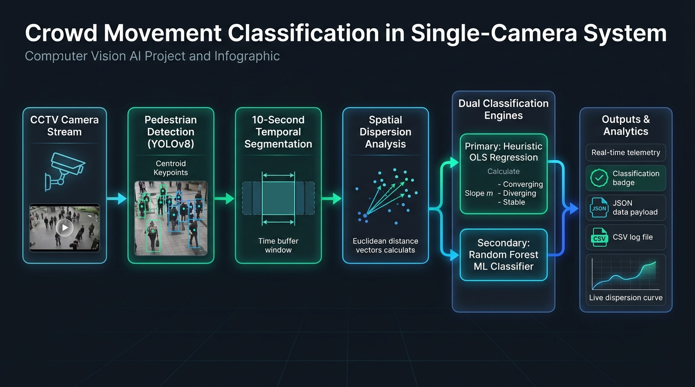
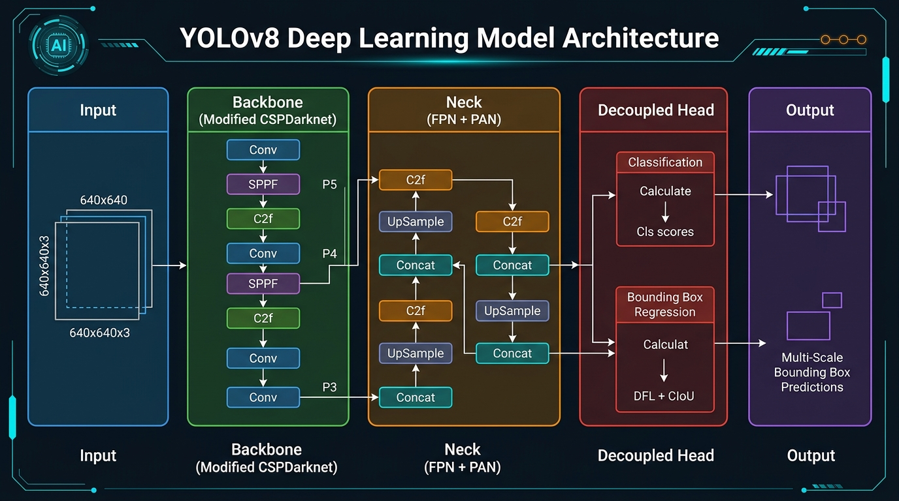

# Crowd Movement Classification in Single-Camera System

[](https://www.python.org/)
[](https://pytorch.org/)
[](https://github.com/ultralytics/ultralytics)
[](https://scikit-learn.org/)
[](https://opencv.org/)
[](file:///d:/EDUCATION/CODEING/CROWD_DETECTION_SINGLE_CAMERA/LICENSE)
[](file:///d:/EDUCATION/CODEING/CROWD_DETECTION_SINGLE_CAMERA/Guide/Chandan%20Msc%20project%20report.pdf)
[](file:///d:/EDUCATION/CODEING/CROWD_DETECTION_SINGLE_CAMERA/Guide/SYSTEM-ARCHITECTURE.md)

> **M.Sc. Computer Science Thesis Project (Semester-IV, 2025)**  
> **Institution**: Department of Computer Science and Engineering, University of Calcutta (Technology Campus)  
> **Author**: Chandan Adhikary (`Roll: C91/CSC/231009`, `Reg: D01-1111-0026-23`)  
> **Project Supervisor**: Prof. Banani Saha  
> **Head of Department**: Prof. Sankhayan Choudhury  
> **Faculty Advisor**: Prof. Sunirmal Khatua  
> **Dissertation Document**: [Guide/Chandan Msc project report.pdf](file:///d:/EDUCATION/CODEING/CROWD_DETECTION_SINGLE_CAMERA/Guide/Chandan%20Msc%20project%20report.pdf)  
> **System Architecture**: [Guide/SYSTEM-ARCHITECTURE.md](file:///d:/EDUCATION/CODEING/CROWD_DETECTION_SINGLE_CAMERA/Guide/SYSTEM-ARCHITECTURE.md)  
> **License**: [MIT License (Open Source & Open to All)](file:///d:/EDUCATION/CODEING/CROWD_DETECTION_SINGLE_CAMERA/LICENSE)

---

### 🏛️ System Architecture Overview

<p align="center">
  
</p>

---

## 📑 Table of Contents

1. [Executive Summary & Motivation](#1-executive-summary--motivation)
2. [Macro Crowd Behavior Taxonomy](#2-macro-crowd-behavior-taxonomy)
3. [Comprehensive Tech-Stack & Hardware Matrix](#3-comprehensive-tech-stack--hardware-matrix)
4. [Mathematical Formulation & Algorithmic Pipeline](#4-mathematical-formulation--algorithmic-pipeline)
5. [Experimental Benchmarks & Results](#5-experimental-benchmarks--results)
6. [Granular Repository Structure](#6-granular-repository-structure)
7. [Step-by-Step Execution Guide](#7-step-by-step-execution-guide)
   - [7.1 Environment Setup & Installation](#71-environment-setup--installation)
   - [7.2 Input Preparation & Directory Setup](#72-input-preparation--directory-setup)
   - [7.3 Running the Main Pipeline (main.py)](#73-running-the-main-pipeline-mainpy)
   - [7.4 Fast Stub Caching (Accelerated Iteration)](#74-fast-stub-caching-accelerated-iteration)
   - [7.5 Accuracy Evaluation (compute_accuracy.py)](#75-accuracy-evaluation-compute_accuracypy)
   - [7.6 Training the Machine Learning Classifier (random_forest.py)](#76-training-the-machine-learning-classifier-random_forestpy)
   - [7.7 Generating Visualization Reports (plot.py)](#77-generating-visualization-reports-plotpy)
8. [Data Contracts, Schemas & Output Formats](#8-data-contracts-schemas--output-formats)
9. [Troubleshooting & FAQs](#9-troubleshooting--faqs)
10. [Future Scope & Research Roadmap](#10-future-scope--research-roadmap)
11. [Academic References & Citation](#11-academic-references--citation)
12. [License (Open to All)](#12-license-open-to-all)

---

## 1. Executive Summary & Motivation

In urban surveillance contexts (railway stations, sports stadiums, pilgrimage sites, shopping arcades, and transit terminals), automated crowd monitoring is a matter of life safety. Crowd build-ups and stampedes typically occur when large volumes of people converge into bottlenecks faster than dispersal can accommodate.

Traditional vision-based crowd analysis approaches suffer from distinct drawbacks:
- **Multi-camera setups** require expensive hardware, complex calibration, and homography alignment.
- **Deep Multi-Object Tracking (MOT)** (such as DeepSORT or ByteTrack) attempts to maintain persistent IDs across frames, which invariably breaks down during heavy visual occlusions, yielding severe ID switching.
- **Optical flow field stability solvers** and spatio-temporal 3D CNNs demand massive computational power and act as black boxes lacking operational transparency.

### The Innovation
This project introduces a **lightweight, interpretable, single-camera computer vision framework** that:
1. Segments CCTV videos into **10-second temporal windows**.
2. Performs frame-by-frame pedestrian detection using **YOLOv8** to obtain bounding boxes $[x, y, w, h]$ and centroids.
3. Computes a physical **Spatial Dispersion Metric** ($D_t$) representing the mean Euclidean distance of detected individuals from the crowd's instantaneous center of mass.
4. Fits an **Ordinary Least Squares (OLS) linear regression** to the dispersion time-series within each segment to calculate its slope ($m = \frac{\Delta D}{\Delta t}$).
5. Classifies segment behavior into **Converging**, **Diverging**, or **Stable** via an empirically optimized threshold heuristic, achieving **84.38% benchmark accuracy**.
6. Evaluates an auxiliary **Random Forest** supervised learning extension trained on engineered statistical dispersion features.

---

## 2. Macro Crowd Behavior Taxonomy

Within every 10-second temporal segment, the crowd dynamics are categorized into one of three macro-states:

```
               ┌────────────────────────────────────────────────────────┐
               │                MACRO CROWD BEHAVIORS                   │
               └────────────────────────────────────────────────────────┘
                                           │
         ┌─────────────────────────────────┼─────────────────────────────────┐
         ▼                                 ▼                                 ▼
   [ CONVERGING ]                    [ DIVERGING ]                     [ STABLE ]
   Inward Compression                Outward Expansion                 Steady-State Spread
   m < -0.02                         m > +0.10                         -0.02 <= m <= +0.10
   Bottleneck build-up               Evacuation / Dispersal            Orderly transit / Queuing
```

| Behavior Class | Physical Description | Mathematical Condition | Real-World Surveillance Context |
| :--- | :--- | :--- | :--- |
| **Converging** | Individuals are moving towards each other or concentrating around a focal point. Spatial compactness increases over time. | Regression slope $m < \theta_l$<br>($\theta_l = -0.02$) | Crowd gathering at entry gates, bottlenecks, stage fronts; potential stampede precursor. |
| **Diverging** | Individuals are moving away from each other or dispersing from a central location. Spatial compactness decreases. | Regression slope $m > \theta_u$<br>($\theta_u = +0.10$) | Event dispersal, exiting transit stations, scatter due to emergency or incident. |
| **Stable** | Crowd maintains uniform spatial dispersion over time; net inward/outward motion is balanced. | Threshold band:<br>$-0.02 \le m \le +0.10$ | Stationary queues, uniform bidirectional hallway walking, steady-state pedestrian flow. |

---

## 3. Comprehensive Tech-Stack & Hardware Matrix

### 3.1 Tested Development Hardware
- **Processor**: AMD Ryzen 7 5800HS (8 Cores, 16 Threads, 3.20 GHz base, up to 4.40 GHz boost, 16 MB L3 Cache)
- **RAM**: 16 GB DDR4-3200 MHz dual-channel
- **Storage**: 512 GB PCIe Gen 3.0 NVMe SSD
- **Graphics Card (GPU)**: NVIDIA GeForce RTX 3050 Laptop GPU (4 GB GDDR6 VRAM, CUDA Compute Capability 8.6, 2048 CUDA Cores)

### 3.2 Software & Dependency Stack

| Technology Layer | Package / Tool | Version | Purpose in Pipeline |
| :--- | :--- | :--- | :--- |
| **Operating System** | Microsoft Windows 11 | 64-bit | Primary development and testing environment |
| **Language Runtime** | Python | `3.12.7` | Core programming language |
| **Deep Learning Engine** | `torch` | `~=2.6.0+cu126` | PyTorch backend with CUDA 12.6 acceleration |
| **Vision Transformers** | `torchvision` | `~=0.21.0+cu126` | PyTorch vision operators and transforms |
| **Audio Core** | `torchaudio` | `==2.5.0+cu124` | PyTorch audio dependency companion |
| **Object Detection** | `ultralytics` | `~=8.3.70` | YOLOv8 nano (`yolov8n.pt`) and extra-large (`yolov8x.pt`) models |
| **Computer Vision I/O** | `opencv-python` | `~=4.11.0.86` | Video decoding (`VideoCapture`), frame rendering, and metadata |
| **Statistical Analysis** | `scipy` | `~=1.15.0` | Ordinary Least Squares regression (`scipy.stats.linregress`) |
| **Numerical Processing** | `numpy` | `~=2.1.1` | Vectorized Euclidean distance, coordinates, and arrays |
| **Data Engineering** | `pandas` | `==2.2.3` | Tabular parsing, bounding box CSV logging, and segment merging |
| **Machine Learning** | `scikit-learn` | `~=1.6.1` | Random Forest classifier, confusion matrix, classification report |
| **Model Persistence** | `joblib` | `~=1.4.2` | Serialization of trained ML models (`rf_model.joblib`) |
| **Visualization & Plots** | `matplotlib` | `~=3.10.0` | Rendering per-segment dispersion plots and regression lines |
| **Statistical Charts** | `seaborn` | `==0.13.2` | Confusion matrix heatmaps and per-video accuracy bar charts |

---

## 4. Mathematical Formulation & Algorithmic Pipeline

### Deep Learning Pedestrian Detector (YOLOv8)

The foundation of the detection pipeline is **YOLOv8** (Ultralytics), an anchor-free convolutional architecture that extracts high-level semantic features and performs multi-scale bounding box regression in real time:

<p align="center">
  
</p>

### Step 1: Pedestrian Centroid Extraction
Each frame $t$ is processed by YOLOv8. For each detection of class `person` (`cls == 0`) with confidence score $\ge 0.20$, bounding box coordinates are extracted as $[x, y, w, h]$.

The spatial anchor (centroid) of pedestrian $i$ is calculated as:
$$c_{i, t} = \left( x_i + \frac{w_i}{2}, \; y_i + \frac{h_i}{2} \right)$$

### Step 2: Crowd Global Center of Mass
For $n_t$ detected individuals in frame $t$, the crowd's collective geometric center $C_t = (C_{x, t}, C_{y, t})$ is:
$$C_{x, t} = \frac{1}{n_t} \sum_{i=1}^{n_t} c_{i, x, t}, \quad C_{y, t} = \frac{1}{n_t} \sum_{i=1}^{n_t} c_{i, y, t}$$

### Step 3: Spatial Dispersion Metric ($D_t$)
The dispersion $D_t$ measures the average Euclidean spread of all detected individuals from the collective center $C_t$:
$$D_t = \frac{1}{n_t} \sum_{i=1}^{n_t} \sqrt{(c_{i, x, t} - C_{x, t})^2 + (c_{i, y, t} - C_{y, t})^2}$$
*Edge case*: If $n_t = 0$, $D_t = 0.0$.

### Step 4: 10-Second Temporal Segmentation
Videos are partitioned into non-overlapping temporal windows of $d = 10\text{ seconds}$:
$$\text{Frames per segment } N = \lfloor \text{FPS} \times d \rfloor$$
For a $30\text{ FPS}$ stream, each segment contains $N = 300\text{ frames}$.
- **Cognitive Justification**: Human perception operates effectively within an 8–12 second window when analyzing group dynamics. Short windows (2–5s) suffer from gait noise, while long windows (20–30s) smooth over sudden panic stampedes.

### Step 5: Ordinary Least Squares (OLS) Linear Regression
Inside each segment, we map normalized relative frame indices $x = [0, 1, \dots, N-1]$ to observed dispersion values $y = [D_0, D_1, \dots, D_{N-1}]$.

The linear model $y = mx + c$ minimizes the sum of squared errors:
$$m = \frac{N \sum_{i=0}^{N-1} x_i y_i - \left(\sum_{i=0}^{N-1} x_i\right) \left(\sum_{i=0}^{N-1} y_i\right)}{N \sum_{i=0}^{N-1} x_i^2 - \left(\sum_{i=0}^{N-1} x_i\right)^2}$$

The slope $m$ represents the rate of dispersion change ($\frac{\mathrm{d}D}{\mathrm{d}t}$).

### Step 6: Heuristic Decision Function
$$\text{Class} = \begin{cases}
\textbf{Converging}, & \text{if } m < -0.02 \\
\textbf{Diverging},  & \text{if } m > +0.10 \\
\textbf{Stable},     & \text{if } -0.02 \le m \le +0.10
\end{cases}$$

---

## 5. Experimental Benchmarks & Results

The system was benchmarked against manual ground-truth annotations across multiple real-world surveillance sequences.

### 5.1 Primary Heuristic Classifier (Full Test Set: 32 Segments)

| Class | Precision | Recall | F1-Score | Support |
| :--- | :---: | :---: | :---: | :---: |
| **Converging** | **0.85** | **1.00** | **0.92** | 11 |
| **Diverging** | 0.67 | 0.67 | 0.67 | 6 |
| **Stable** | **0.92** | 0.80 | **0.86** | 15 |
| **Overall Accuracy** | — | — | **84.38% (0.84)** | **32** |
| **Macro Average** | 0.81 | 0.82 | 0.81 | 32 |
| **Weighted Average** | 0.85 | 0.84 | 0.84 | 32 |

#### Confusion Matrix
```
                    Predicted Converging    Predicted Diverging    Predicted Stable
Actual Converging            11                      0                     0
Actual Diverging              1                      4                     1
Actual Stable                 1                      2                    12
```

### 5.2 Threshold Optimization Grid ($\theta_l$ vs $\theta_u$)
A grid search over threshold pairs validated that $\theta_l = -0.02$ and $\theta_u = 0.10$ achieves maximum classification performance:
- $\theta_l = -0.02, \theta_u = 0.10 \implies \mathbf{84.38\%}$
- $\theta_l = -0.03, \theta_u = 0.10 \implies 81.25\%$
- $\theta_l = -0.01, \theta_u = 0.10 \implies 81.25\%$
- $\theta_l = -0.04, \theta_u = 0.20 \implies 75.00\%$

### 5.3 Auxiliary Random Forest Classifier (8 Test Videos)
Trained on 5 statistical features (`slope_dispersion`, `avg_dispersion`, `dispersion_std_dev`, `dispersion_change`, `segment_length_frames`):
- **Accuracy**: **75.00%**
- **Converging**: F1 = 1.00 | **Stable**: F1 = 0.67 | **Diverging**: F1 = 0.50
- **Finding**: While Random Forest effectively learns non-linear decision boundaries on subtle transitions, the heuristic method remains superior for production deployment due to its zero data requirement, complete transparency, and higher overall accuracy.

---

## 6. Granular Repository Structure

```
CROWD_DETECTION_SINGLE_CAMERA/
│
├── Guide/                                   # Documentation & Academic Assets Hub
│   ├── Chandan Msc project report.pdf       # 44-page University of Calcutta Master's thesis
│   ├── SYSTEM-ARCHITECTURE.md               # In-depth architectural design specification & diagrams
│   ├── system_architecture.jpg              # High-resolution modern system architecture infographic
│   └── yolov8_architecture.jpg              # YOLOv8 deep learning model architecture diagram
│
├── .idea/                                   # PyCharm project configuration files
│
├── compute_accuracy.py                      # Evaluates predictions against JSON ground truth
├── detector.py                              # YOLOv8 wrapper with GPU support and pickle stub caching
├── environment_setup.md                     # Hardware and virtual environment documentation
├── heuristics.py                            # Core centroid, dispersion, regression & heuristic classification
├── LICENSE                                  # MIT Open-Source License (Open to all)
├── main.py                                  # Primary pipeline orchestrator entrypoint
├── plot.py                                  # Seaborn visualization for confusion matrix & per-video charts
├── random_forest.py                         # Supervised Machine Learning extension module
├── requirements.txt                         # Pinned pip dependencies
├── utils.py                                 # Video decoding, CSV bounding box logging & centroid parsing
└── README.md                                # Root technical and execution guide (this file)
```

---

## 7. Step-by-Step Execution Guide

Follow this definitive walkthrough to set up the environment and execute every phase of the project.

### 7.1 Environment Setup & Installation

#### Step 1: Open Terminal & Clone/Open Directory
Ensure your terminal is located in the project root directory:
```bash
cd D:\EDUCATION\CODEING\CROWD_DETECTION_SINGLE_CAMERA
```

#### Step 2: Create a Clean Python Virtual Environment
Use Python 3.12 (recommended: Python `3.12.7`):
```bash
# Windows Command Prompt / PowerShell:
python -m venv .venv

# Activate the virtual environment:
# On Windows:
.venv\Scripts\activate

# On Linux / macOS:
source .venv/bin/activate
```

#### Step 3: Install PyTorch with GPU CUDA Acceleration
If an NVIDIA GPU with CUDA 12.x is available, install the official PyTorch CUDA build first:
```bash
pip install torch==2.6.0+cu126 torchvision==0.21.0+cu126 torchaudio==2.5.0+cu124 --index-url https://download.pytorch.org/whl/cu126
```
*(If running on a CPU-only machine, standard PyTorch will be installed automatically from `requirements.txt`).*

#### Step 4: Install Project Dependencies
```bash
pip install -r requirements.txt
```

---

### 7.2 Input Preparation & Directory Setup

Before running inference, prepare your video and ground-truth label files:
1. Place your target CCTV video (e.g., `crowd_sample.mp4`) in your workspace.
2. Ensure you have a ground truth JSON file (e.g., `ground_truth_label.json`) matching the segment duration:
```json
{
  "0": {
    "label": "stable",
    "duration": 10
  },
  "1": {
    "label": "converging",
    "duration": 10
  },
  "2": {
    "label": "diverging",
    "duration": 10
  }
}
```

---

### 7.3 Running the Main Pipeline (`main.py`)

`main.py` is the primary orchestrator that executes the entire detection, dispersion calculation, and classification pipeline.

#### Step 1: Configure Video & Label Paths in `main.py`
Open `main.py` and specify your input video path:
```python
# In main.py:
def main():
    video_path = "path_to_video.mp4"  # <-- Point to your local CCTV video file
    frames, fps = read_frames(video_path)
    
    detector_model = Detector("yolov8n.pt")  # Or "yolov8x.pt" for higher precision
    bboxes = detector_model.get_bboxes(frames)
    save_csv(bboxes, fps, "bboxes_output.csv")
    
    with open("ground_truth_label.json", "r") as f:
        gt_labels = json.load(f)
        
    positions_by_time = load_positions_from_csv("bboxes_output.csv")
    classify_segments_by_slope(video_path, gt_labels, positions_by_time, fps,
                               lower_slope_threshold=-0.02,
                               upper_slope_threshold=0.1,
                               output_plot_dir="plots")
```

#### Step 2: Execute
```bash
python main.py
```

#### What Happens During Execution:
1. `utils.read_frames()` ingests the video using OpenCV and reads the native FPS.
2. `detector.Detector` passes each frame to YOLOv8 on `cuda:0` and extracts bounding boxes for all pedestrians.
3. `utils.save_csv()` writes all detections to `bboxes_output.csv`.
4. `heuristics.classify_segments_by_slope()` computes the spatial dispersion for every frame, divides the video into 10-second segments, fits OLS regression lines, and assigns `Converging`, `Diverging`, or `Stable` labels.
5. **Outputs Generated**:
   - `plots/<video>/output_labels.json` containing segment labels and statistical metrics.
   - `plots/<video>/<video>_segment_data.csv` containing tabular metrics.
   - `plots/<video>/segment_0.png`, `segment_1.png`, etc., depicting dispersion curves and red dashed regression slope lines.

---

### 7.4 Fast Stub Caching (Accelerated Iteration)

Running deep learning object detection on every execution can be slow for large videos. `detector.py` provides a built-in **pickle stub mechanism**:

To enable caching, configure `main.py`:
```python
# detector.py get_bboxes supports read_from_stub:
bboxes = detector_model.get_bboxes(
    frames, 
    read_from_stub=True, 
    stub_path="detections_cache.pkl"
)
```
- **First Run**: Runs full YOLOv8 GPU detection and dumps results to `detections_cache.pkl`.
- **Subsequent Runs**: Instantly loads bounding boxes from disk in milliseconds, allowing instant re-testing of dispersion thresholds and heuristic parameters.

---

### 7.5 Accuracy Evaluation (`compute_accuracy.py`)

`compute_accuracy.py` benchmarks the generated heuristic predictions against ground truth labels across multiple video sequences.

#### Step 1: Verify Label Directories
Ensure the paths match your experiment folder:
```python
# In compute_accuracy.py:
with open("labels/input_labels_80.json", "r") as f:
    ground_truth = json.load(f)

dirs = os.listdir("plots_new_threshold/input_videos")
```

#### Step 2: Execute
```bash
python compute_accuracy.py
```

#### Console Output:
```
Video: video_1
  Total segments: 4
  Correctly predicted: 4
  Accuracy: 100.00%

Video: video_8
  Total segments: 5
  Correctly predicted: 5
  Accuracy: 100.00%

Overall accuracy across all videos: 84.38%

              precision    recall  f1-score   support
  converging       0.85      1.00      0.92        11
   diverging       0.67      0.67      0.67         6
      stable       0.92      0.80      0.86        15
    accuracy                           0.84        32
```

---

### 7.6 Training the Machine Learning Classifier (`random_forest.py`)

To train and evaluate the auxiliary Random Forest model on the extracted segment features:

#### Step 1: Set the Segment Directory Path
```python
# In random_forest.py:
if __name__ == "__main__":
    path = "plots/input_videos"  # Directory containing {video}_segment_data.csv files
    df = get_dataframe(path)
    trained_model, label_map = train_random_forest(df)
```

#### Step 2: Execute
```bash
python random_forest.py
```

#### Outputs:
1. Fits a 100-tree Random Forest (`n_estimators=100`, `max_depth=5`, `random_state=42`).
2. Displays the classification report and confusion matrix.
3. Opens a horizontal bar chart displaying **Feature Importances** (showing `slope_dispersion` as the dominant predictor).
4. Persists the trained model to `rf_model.joblib`.

---

### 7.7 Generating Visualization Reports (`plot.py`)

To generate publication-ready comparative bar charts and heatmaps:

#### Execute:
```bash
python plot.py
```

#### Displays:
1. **Per-Video Segment Classification Accuracy Bar Chart** with color gradients and an overall benchmark reference line ($84.38\%$).
2. **Seaborn Confusion Matrix Heatmap** displaying true vs. predicted counts across classes.

---

## 8. Data Contracts, Schemas & Output Formats

### 8.1 `bboxes_output.csv` (Pedestrian Coordinates)
```csv
frame,time,x,y,w,h
0,0.0,312.4,142.1,35.2,85.6
0,0.0,520.1,190.5,41.0,92.3
1,0.033,313.0,142.8,35.0,85.4
```

### 8.2 `output_labels.json` (Segment Classification JSON)
```json
{
  "segment_0": {
    "start_frame": 0,
    "end_frame": 299,
    "slope": -0.0482,
    "average_dispersion": 195.42,
    "dispersion_std_dev": 18.35,
    "dispersion_change": -14.28,
    "segment_length": 300,
    "label": "Converging",
    "gt_label": "converging"
  },
  "segment_1": {
    "start_frame": 300,
    "end_frame": 599,
    "slope": 0.0034,
    "average_dispersion": 182.11,
    "dispersion_std_dev": 6.12,
    "dispersion_change": 1.15,
    "segment_length": 300,
    "label": "Stable",
    "gt_label": "stable"
  }
}
```

### 8.3 `{video}_segment_data.csv` (Tabular Feature Log)
```csv
video,segment_id,start_frame,end_frame,slope_dispersion,avg_dispersion,dispersion_std_dev,dispersion_change,segment_length_frames,pred_label,gt_label
video_1,segment_0,0,299,-0.0482,195.42,18.35,-14.28,300,Converging,converging
```

---

## 9. Troubleshooting & FAQs

### Q1: `NameError: name 'pd' is not defined` in `utils.py`
- **Cause**: In `utils.py`, `save_csv()` uses `pd.DataFrame`, but `import pandas as pd` is missing from the file header.
- **Fix**: Add `import pandas as pd` at line 1 of `utils.py`.

### Q2: CUDA out of memory or `device='cuda:0'` fails on non-NVIDIA systems
- **Cause**: The default `detector.py` attempts to run on `device="cuda:0"`.
- **Fix**: If running on a CPU-only environment or integrated graphics, update `detector.py`:
  ```python
  d = self.model.predict(frame, device="cpu", conf=0.2)
  ```

### Q3: Why is my video classified entirely as Stable?
- **Cause**: If camera shake or wide dispersion occurs, the threshold window may be too broad.
- **Fix**: Tune `lower_slope_threshold` and `upper_slope_threshold`. The optimal empirical setting is `-0.02` and `0.10`.

### Q4: YOLOv8 model download takes long or times out
- **Cause**: Ultralytics automatically downloads pretrained weights (`yolov8n.pt` ~6 MB, `yolov8x.pt` ~136 MB) on first invocation.
- **Fix**: Ensure internet connectivity during the first run of `main.py`, or manually place `yolov8n.pt` into the workspace.

---

## 10. Future Scope & Research Roadmap

1. **Multi-Camera Homographic Coordinate Fusion**:
   - Aligning overlapping and non-overlapping surveillance views into a global metric ground-plane using planar homography matrices $H$, enabling campus-wide crowd dispersion monitoring.
2. **Optical Flow & Directional Velocity Integration**:
   - Augmenting centroid dispersion with local Lucas-Kanade or Farnebäck optical flow fields to measure crowd turbulence, velocity coherence, and opposing flow collisions.
3. **Semi-Supervised Active Learning**:
   - Utilizing the 84.38% accurate heuristic classifier to auto-annotate unlabelled CCTV streams and iteratively fine-tune deep spatio-temporal architectures (such as Video Swin Transformers or ConvLSTM).
4. **Embedded Edge Deployment**:
   - Quantizing YOLOv8 to FP16/INT8 with TensorRT for zero-latency execution on embedded edge devices (e.g., NVIDIA Jetson Orin Nano).

---

## 11. Academic References & Citation

If you use or build upon this research, please cite the original dissertation:

```bibtex
@mastersthesis{adhikary2025crowd,
  author    = {Chandan Adhikary},
  title     = {Crowd Movement Classification in Single-Camera System},
  school    = {Department of Computer Science and Engineering, University of Calcutta},
  year      = {2025},
  month     = {June},
  type      = {Master of Science (M.Sc.) Project Report},
  address   = {Kolkata, India},
  note      = {Supervised by Prof. Banani Saha}
}
```

### Core Literature
1. **Redmon, J., et al.** (2016). *You only look once: Unified, real-time object detection*. CVPR, pp. 779–788.
2. **Reis, D., et al.** (2023). *Real-time flying object detection with YOLOv8*. arXiv:2305.09972.
3. **Zhan, A., et al.** (2018). *Detection of dispersion in crowd scenes for surveillance applications*. ICPR, pp. 1234–1240.
4. **Solmaz, B., et al.** (2012). *Identifying behaviors in crowd scenes using stability analysis for dynamical systems*. IEEE TPAMI, 34(10), pp. 2064–2070.
5. **Sultani, W., et al.** (2018). *Real-world anomaly detection in surveillance videos*. CVPR, pp. 6479–6488.

---

## 12. License (Open to All)

This project is licensed under the **MIT License** — free and open for academic, personal, research, and commercial use.

```
MIT License

Copyright (c) 2025 Chandan Adhikary

Permission is hereby granted, free of charge, to any person obtaining a copy
of this software and associated documentation files (the "Software"), to deal
in the Software without restriction, including without limitation the rights
to use, copy, modify, merge, publish, distribute, sublicense, and/or sell
copies of the Software, and to permit persons to whom the Software is
furnished to do so, subject to the following conditions:

The above copyright notice and this permission notice shall be included in all
copies or substantial portions of the Software.

THE SOFTWARE IS PROVIDED "AS IS", WITHOUT WARRANTY OF ANY KIND, EXPRESS OR
IMPLIED, INCLUDING BUT NOT LIMITED TO THE WARRANTIES OF MERCHANTABILITY,
FITNESS FOR A PARTICULAR PURPOSE AND NONINFRINGEMENT. IN NO EVENT SHALL THE
AUTHORS OR COPYRIGHT HOLDERS BE LIABLE FOR ANY CLAIM, DAMAGES OR OTHER
LIABILITY, WHETHER IN AN ACTION OF CONTRACT, TORT OR OTHERWISE, ARISING FROM,
OUT OF OR IN CONNECTION WITH THE SOFTWARE OR THE USE OR OTHER DEALINGS IN THE
SOFTWARE.
```
See the full [`LICENSE`](file:///d:/EDUCATION/CODEING/CROWD_DETECTION_SINGLE_CAMERA/LICENSE) file in the root directory.
